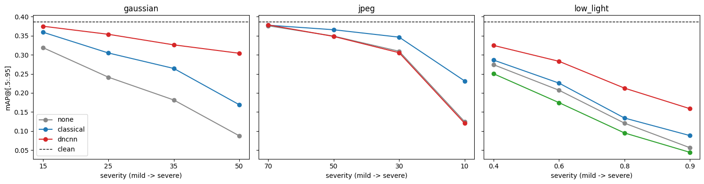
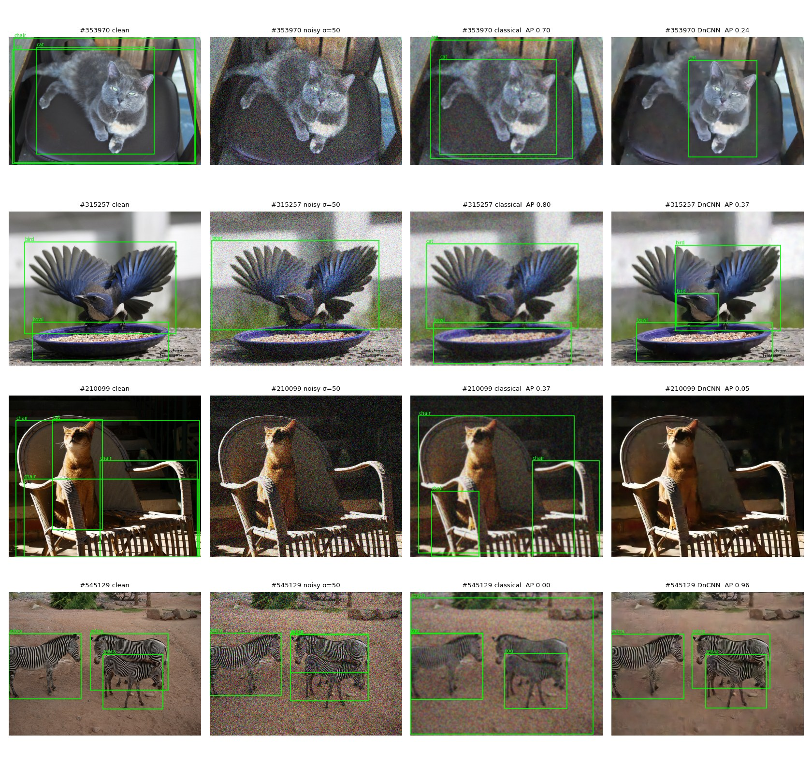

# Degrade → Restore → Detect

**Does repairing a damaged image help a computer find the objects in it, or does it only make the picture look better?**

Images reach vision systems damaged: grainy from small sensors, blocky from compression, too dark. Restoration methods are usually graded by pixel closeness to the original (PSNR). This project tests whether that grade predicts what matters downstream: object-detection accuracy.

1. **Degrade:** clean photos are damaged in seven controlled, seeded ways (Gaussian, Poisson and salt-and-pepper noise, blur, JPEG, colour cast, low light), at five strengths each.
2. **Restore:** repairs use tuned classical filters, colour-space-aware denoising, contrast enhancement, matched inverses (gray-world, Wiener), and a blind DnCNN trained from scratch.
3. **Detect:** a pretrained YOLOv8n is scored with COCO mAP on clean, damaged and repaired images.

The full write-up is in [`report/report.pdf`](report/report.pdf).

## Key findings

| Damage | What helps detection | PSNR a good guide? |
|---|---|---|
| Gaussian noise | DnCNN recovers **70–83%** of the lost mAP; tuned classical filters 27–60% | Yes |
| JPEG compression | Bilateral filter recovers 41–48% at quality 10–50; DnCNN (never trained on JPEG) does not help | Ranking yes, size no |
| Low light | DnCNN is best (31–45%); CLAHE has the **best PSNR but the worst mAP** in all four conditions | **No** |



Looking inside the trained DnCNN explains why. 43 of its 64 first-layer filters are colour-opponent, so it rediscovered the luma/chroma split by itself. It also widens its effective receptive field as noise grows, and it keeps up to 1.9× more spatial frequency than the best classical filter. It fails visibly on damage it never saw: on JPEG and blur it produces streaks along strong edges.



## Built from scratch and verified

| Component | Check | Result |
|---|---|---|
| JPEG codec (DCT, quantisation, zigzag, run-length entropy) | PSNR against libjpeg at the same quality | within 0.05 dB up to q = 90 |
| Conv layer forward and backward pass (NumPy) | gradient check against numerical gradients | relative error ≤ 7e-10 |
| Blind DnCNN (17 layers, 558k parameters) | PSNR against the published model on CBSD68 | within 0.2 dB (33.76 / 31.05 / 27.69 dB at σ = 15 / 25 / 50) |
| Degradation models | statistical tests (noise std, Poisson variance, …) | all 9 pass |

## Repository layout

```
notebooks/
  01_degradations_and_baselines.ipynb   damage models, PSNR/SSIM, classical filters, colour spaces, HE/CLAHE, Wiener
  02_jpeg_from_scratch.ipynb            JPEG codec in NumPy, rate-distortion against OpenCV
  03_numpy_conv_gradcheck.ipynb         conv layer forward/backward, gradient checks, im2col
  04_dncnn_training.ipynb               blind DnCNN training and evaluation (Kaggle GPU)
  05_detection_eval.ipynb               YOLOv8n mAP under damage and restoration (Kaggle GPU)
  06_denoiser_analysis.ipynb            filters, receptive field, frequency response, failure gallery
degradations.py      damage functions shared by notebooks 01, 04, 05 and 06 (written by notebook 01)
results/             tuned filter settings, PSNR tables, DnCNN checkpoint, mAP summary, analysis CSVs
figures/             the 23 figures used in the report
report/report.pdf    full report
```

All notebooks are saved with their outputs, so the results can be read without re-running.

## Running it

```bash
pip install -r requirements.txt
```

- **Notebooks 01–03** run on a laptop CPU. Notebook 01 expects the BSD500 dataset; on Kaggle, attach *Berkeley Segmentation Dataset 500* (balraj98).
- **Notebooks 04–06** need a GPU; they were run on Kaggle (T4). Notebook 05 downloads COCO val2017 and YOLOv8n. Notebooks 05 and 06 load `results/04/dncnn_last.pt` and `results/01/best_classical.json` as inputs.

## Reproducibility

All randomness is seeded. Each noisy image is seeded by its (image, degradation, severity) indices, so every method is compared on the identical damaged input. The 100 BSD500 validation images are split into 4 tuning and 96 test images; DnCNN is trained on the 400 train and test images, with no overlap (checked by file name and pixel hash). Detection uses a fixed random subset of 300 COCO val2017 images.

## Limitations

There is one detector, and only 300 COCO images. All damage is synthetic. DnCNN was trained on Gaussian noise only. The classical filters were tuned with knowledge of the true severity, which favours them. Details are in section 14 of the report.

## References

- K. Zhang et al., *Beyond a Gaussian Denoiser: Residual Learning of Deep CNN for Image Denoising* (DnCNN), IEEE TIP 2017.
- Berkeley Segmentation Dataset (BSDS500); COCO 2017; Ultralytics YOLOv8.
